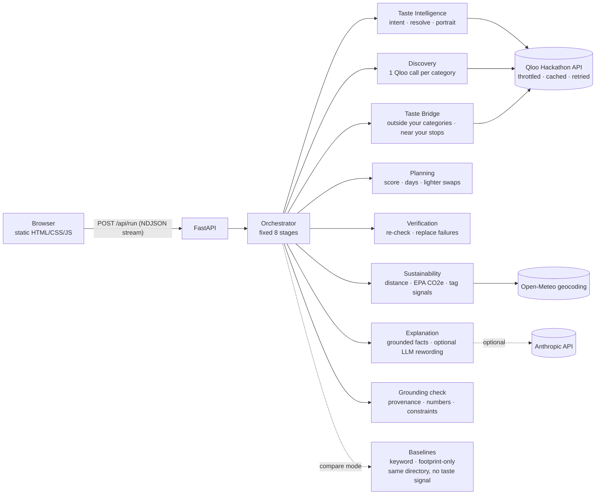

# EarthPulse AI

**Your taste. A lighter footprint.**

Cultural intelligence for sustainable experiences: day plans that feel like you, with the travel-emissions evidence behind every pick.

EarthPulse turns a few things you love (a film, an artist, a book, a vibe) into a 1–2 day plan for any city.
[Qloo's Taste AI](https://www.qloo.com) finds the places that people with your taste love. EarthPulse then
puts every pick on the scale: straight-line distance, round-trip travel CO2e from U.S. EPA emission factors,
and a **lighter swap** whenever a much closer place is nearly as good a taste match.

- **Live demo:** https://earthpulse-ai-plos.onrender.com (free tier: the first visit after idle can take ~1 minute to wake)
- **Status, tests and limits:** [docs/RESULTS.md](docs/RESULTS.md) (read this first; it says what is and isn't verified)
- **Built for:** the Qloo LLM Hackathon (2026)
- **License:** MIT

## Why it needs Qloo

Remove Qloo and EarthPulse has nothing to rank. Qloo is used at five points:

| Step | Qloo endpoint | What it gives us |
|---|---|---|
| Match interests | `GET /search` | Your favourites as Qloo entities, across film, music, books, brands, places |
| Match concepts | `GET /v2/tags?filter.query=` | Taste tags for things that aren't entities, like “slow living” |
| Taste portrait | `GET /v2/insights?filter.type=urn:tag` | The genres, keywords and ambience your favourites share |
| Discovery | `GET /v2/insights?filter.type=urn:entity:place` with `signal.interests.*`, `filter.location.query`, `filter.tags` | Real places in your destination ranked by cross-domain affinity |
| Explanation | `feature.explainability=true` | Which of *your* interests drove each match, shown on every card and summed in your Cultural DNA |
| Taste Bridge | a second place-insights call over the categories you *didn't* pick | Strong taste matches outside your usual choices, a short hop from your plan |

The **comparison lab** proves it: it runs the same city, the same Qloo place directory, the same filters and carbon
rules, but ranks one list with your taste signals and the other with plain keyword overlap. You rate both lists blind,
then reveal which was which, alongside measured metrics (overlap, diversity, evidence coverage, latency).

## Evaluation (live Qloo)

A three-arm ablation over five invented personas in Kyoto, Chicago, Lisbon, Portland and Copenhagen, run against the
live deployment ([docs/EVALUATION.md](docs/EVALUATION.md)). All three arms share the same Qloo place directory,
filters, 25 km area and carbon rules. One ranks by **Qloo taste**, one by **keyword** overlap with your words, and
one by **footprint only** (nearest first).

- Qloo changes *what* is recommended: its six picks share on average 0.8 places with the keyword list and 1.0 with
  the footprint-only list.
- Taste did not cost distance here: planned straight-line travel averaged 14.1 km for Qloo, 17.5 km for keyword
  and 14.7 km for footprint-only.
- Where Qloo did not win (theme-match proxy, two cities on distance) is reported as is.

Five personas is a smoke-level sample, so no significance is claimed, and cultural relevance needs the human
blind ratings the Comparison Lab collects. Reproduce with
`python scripts/evaluate.py --url https://earthpulse-ai-plos.onrender.com`.

Judging criteria mapped to code, tests and demo evidence: [docs/TRACEABILITY.md](docs/TRACEABILITY.md).

## Features

- **Live agent timeline.** A ten-stage pipeline streams real backend events to the page as it runs.
- **Cultural DNA.** Bars for the taste themes your favourites share (Qloo tag insights) and which of your interests
  drove the plan (summed Qloo explainability).
- **Taste Bridge.** Places outside the categories you chose that Qloo still rates at least as well as your plan's
  median (−0.05), within 4 km of a planned stop, with the hop's CO2e next to a separate car trip.
- **Adjust and regenerate.** Change days, budget, priorities, car-free or step-free; the agent re-plans and shows
  which stops changed and how travel CO2e moved.
- **Evidence drawer on every card.** Each statement carries a claim label: Listed (Qloo data), Computed (EPA math),
  Qloo signal, AI-written, or Not verified.
- **Lighter swaps**, shown side by side: original pick vs. a closer place that keeps most of the taste match, with
  distance, round-trip CO2e and the taste-match difference computed the same way for both.
- **City-level geography.** A state or country (“Florida”, “Oregon”) is refused before any Qloo call, with city
  choices. Cities are geocoded and validated, then Qloo is asked only for places within 25 km of the city point
  (`filter.location` + radius). A wider area (40 or 60 km) is offered, never applied silently. Partial plans say
  “X of Y stops” and why. Every travel leg names its start and end.
- **Priorities**: low-carbon travel, more time in nature, plant-forward food, secondhand and vintage, car-free,
  step-free entrances (from Qloo's accessibility tag).
- **Day plans** with walk/transit legs between stops and day totals compared with driving.
- **Honest failures**: rate limits, auth errors and empty results are shown as such, never papered over with fake data.

## Trust: verification, adaptation, failure

- **Grounding check before display.** A deterministic validator audits every result against independent records
  of the run: each place must have come from a Qloo response in this run under the same name; credited interests
  must be ones you gave; affinities must equal Qloo's; every number in an explanation must appear in its facts
  (an AI sentence that fails is replaced with the grounded one); all CO2e figures and totals are recomputed; your
  constraints are re-checked. If a hard check fails, the result is withheld.
- **Bounded adaptation.** The agent observes how many places survive your filters per category. If a category
  comes back too thin, it re-queries Qloo once with a wider pool. It never relaxes your constraints.
- **Honest failure.** 429s and 5xx are retried with backoff (bounded); auth errors, timeouts, unknown interests and
  empty cities produce clear messages, never fake data; one failed category degrades the plan instead of killing it.
  `python scripts/failure_drill.py` breaks Qloo and the LLM on purpose in 9 ways: [docs/FAILURE_DRILL.md](docs/FAILURE_DRILL.md).
- **AI is untrusted.** The optional LLM can only extract interests that appear in your text and reword facts; it
  never chooses places or numbers. EarthPulse takes no consequential actions (no booking or payment).

## Architecture



- `app/qloo/` — throttled (≤4 req/s), cached (24 h), retrying client with typed errors; tolerant parsers; category taxonomy.
- `app/agents/` — one module per agent plus the orchestrator. No agent loops: every run makes a bounded, predictable
  number of Qloo calls (about 3 + 2 + one per category).
- `app/evidence/` — EPA emission factors and geodesy.
- `static/` — no-build frontend with Leaflet/OpenStreetMap maps.

Methodology, weights and sources: [docs/METHODOLOGY.md](docs/METHODOLOGY.md). Competitive analysis, gap analysis and
the architecture decision: [docs/STRATEGY.md](docs/STRATEGY.md). Demo script: [docs/DEMO_SCRIPT.md](docs/DEMO_SCRIPT.md).
Release checklist and screenshot plan: [docs/QA_CHECKLIST.md](docs/QA_CHECKLIST.md).

## Run locally

```bash
python -m venv .venv && source .venv/bin/activate
pip install -r requirements-dev.txt
cp .env.example .env             # add QLOO_API_KEY
export $(grep -v '^#' .env | xargs)
uvicorn app.main:app --reload    # http://localhost:8000
```

No key yet? `EARTHPULSE_DEV_FIXTURES=1 uvicorn app.main:app` serves clearly-labelled **synthetic** places
(names start with “[Synthetic]” and a banner says so). It is refused when `ENVIRONMENT=production`.

## Tests

```bash
python -m pytest -q                              # 67 unit + API tests, Qloo mocked with respx
python scripts/failure_drill.py                   # 9 deliberate failure scenarios
python scripts/smoke.py http://localhost:8000     # end-to-end against a running server (live test)
python scripts/evaluate.py --url <deployment> --json eval.json   # 3-arm persona evaluation; exits 1 on a grounding failure
```

Tests never use recorded Qloo responses: Qloo's terms don't allow publishing response data, so mocks are
hand-written or generated synthetically (`app/qloo/fixtures.py`).

## Deploy (Render)

1. New → Blueprint → select this repo (uses `render.yaml`).
2. In the service's Environment tab set `QLOO_API_KEY` (and optionally `ANTHROPIC_API_KEY`).
3. Open the URL, then run `python scripts/smoke.py https://<your-app>.onrender.com`.

The free plan sleeps when idle, so the first request after a pause can take up to a minute.

## Limitations

- Distances are straight-line, so CO2e figures are lower bounds meant for comparison, not route planning. No routing API is used and no travel times are shown.
- EPA factors are U.S. national averages; local fleets differ.
- Lower-impact tags are Qloo taste signals, not certifications. Opening hours are not verified.
- Rate limiting and caching are in-memory (single instance).
- No sustainability certifications or destination policies yet: we found no verifiable source we could use in time,
  so we don't claim any.

## Who it's for

Environmentally conscious city-breakers who want trips that feel like them. Business models (premium planning,
destination licensing, a taste-plus-footprint API for sustainable hotels) are hypotheses; see
[docs/STRATEGY.md](docs/STRATEGY.md).
