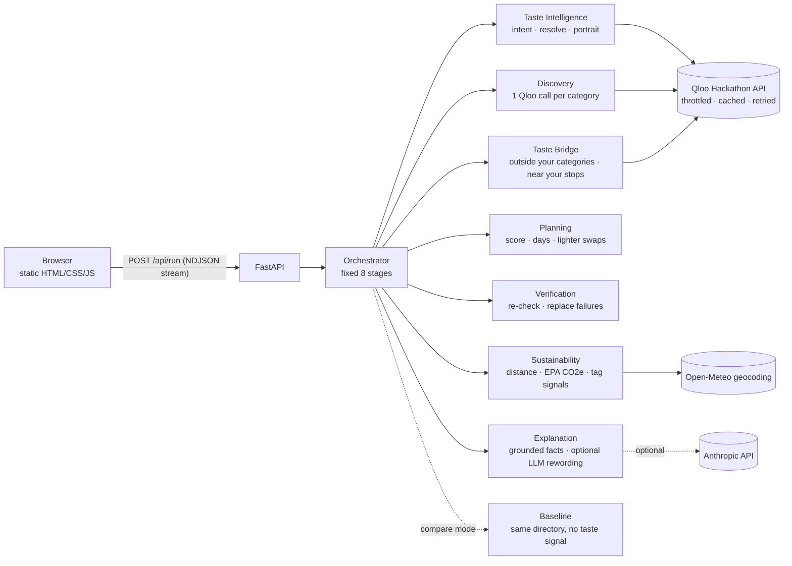

# EarthPulse AI

**Your taste. A lighter footprint.**

Cultural intelligence for sustainable experiences: day plans that feel like you, with the travel-emissions evidence behind every pick.

EarthPulse turns a few things you love (a film, an artist, a book, a vibe) into a 1–2 day plan for any city.
[Qloo's Taste AI](https://www.qloo.com) finds the places that people with your taste love. EarthPulse then
puts every pick on the scale: straight-line distance, round-trip travel CO2e from U.S. EPA emission factors,
and a **lighter swap** whenever a much closer place is nearly as good a taste match.

- **Live demo:** _add your Render URL here_
- **Built for:** the Qloo LLM Hackathon (2026)
- **License:** MIT

## Why it needs Qloo

Remove Qloo and EarthPulse has nothing to rank. Qloo is used at five points:

| Step | Qloo endpoint | What it gives us |
|---|---|---|
| Match interests | `GET /search` | Your favourites as Qloo entities, across film, music, books, brands, places |
| Match concepts | `GET /v2/tags?filter.query=` | Taste tags for things that aren't entities, like “slow living” |
| Taste portrait | `GET /v2/insights?filter.type=urn:tag` | The genres, keywords and ambience your favourites share |
| Discovery | `GET /v2/insights?filter.type=urn:entity:place` with `signal.interests.*`, `filter.location.query`, `filter.tags` | Real places in your destination ranked by cross-domain affinity |
| Explanation | `feature.explainability=true` | Which of *your* interests drove each match, shown on every card and summed in your Cultural DNA |
| Taste Bridge | a second place-insights call over the categories you *didn't* pick | Strong taste matches outside your usual choices, a short hop from your plan |

The **comparison lab** proves it: it runs the same city, the same Qloo place directory, the same filters and carbon
rules, but ranks one list with your taste signals and the other with plain keyword overlap. You rate both lists blind,
then reveal which was which, alongside measured metrics (overlap, diversity, evidence coverage, latency).

## Evaluation

`scripts/evaluate.py` runs five fixed, clearly invented test personas through both rankers and writes aggregate
metrics only to [docs/EVALUATION.md](docs/EVALUATION.md). **Live results are pending the Qloo key on the deployed
server;** until then that file does not exist and no results are claimed. Neither automatic relevance proxy is
neutral (one uses Qloo's portrait, one uses the user's words), so both are reported next to the human blind ratings.

## Features

- **Live agent timeline.** A nine-stage pipeline streams real backend events to the page as it runs.
- **Cultural DNA.** Bars for the taste themes your favourites share (Qloo tag insights) and which of your interests
  drove the plan (summed Qloo explainability).
- **Taste Bridge.** Places outside the categories you chose that Qloo still rates at least as well as your plan's
  median (−0.05), within 4 km of a planned stop, with the hop's CO2e next to a separate car trip.
- **Adjust and regenerate.** Change days, budget, priorities, car-free or step-free; the agent re-plans and shows
  which stops changed and how travel CO2e moved.
- **Evidence drawer on every card.** Each statement carries a claim label: Listed (Qloo data), Computed (EPA math),
  Qloo signal, AI-written, or Not verified.
- **Lighter swaps** with the CO2e difference computed from EPA factors.
- **Priorities**: low-carbon travel, more time in nature, plant-forward food, secondhand and vintage, car-free,
  step-free entrances (from Qloo's accessibility tag).
- **Day plans** with walk/transit legs between stops and day totals compared with driving.
- **Honest failures**: rate limits, auth errors and empty results are shown as such, never papered over with fake data.

## Architecture



- `app/qloo/` — throttled (≤4 req/s), cached (24 h), retrying client with typed errors; tolerant parsers; category taxonomy.
- `app/agents/` — one module per agent plus the orchestrator. No agent loops: every run makes a bounded, predictable
  number of Qloo calls (about 3 + 2 + one per category).
- `app/evidence/` — EPA emission factors and geodesy.
- `static/` — no-build frontend with Leaflet/OpenStreetMap maps.

Methodology, weights and sources: [docs/METHODOLOGY.md](docs/METHODOLOGY.md). Competitive analysis, gap analysis and
the architecture decision: [docs/STRATEGY.md](docs/STRATEGY.md). Demo script: [docs/DEMO_SCRIPT.md](docs/DEMO_SCRIPT.md).
Release checklist and screenshot plan: [docs/QA_CHECKLIST.md](docs/QA_CHECKLIST.md).

## Run locally

```bash
python -m venv .venv && source .venv/bin/activate
pip install -r requirements-dev.txt
cp .env.example .env             # add QLOO_API_KEY
export $(grep -v '^#' .env | xargs)
uvicorn app.main:app --reload    # http://localhost:8000
```

No key yet? `EARTHPULSE_DEV_FIXTURES=1 uvicorn app.main:app` serves clearly-labelled **synthetic** places
(names start with “[Synthetic]” and a banner says so). It is refused when `ENVIRONMENT=production`.

## Tests

```bash
python -m pytest -q                              # 43 unit + API tests, Qloo mocked with respx
python scripts/smoke.py http://localhost:8000     # end-to-end against a running server (live test)
python scripts/evaluate.py --out docs/EVALUATION.md   # persona evaluation (needs QLOO_API_KEY)
```

Tests never use recorded Qloo responses: Qloo's terms don't allow publishing response data, so mocks are
hand-written or generated synthetically (`app/qloo/fixtures.py`).

## Deploy (Render)

1. New → Blueprint → select this repo (uses `render.yaml`).
2. In the service's Environment tab set `QLOO_API_KEY` (and optionally `ANTHROPIC_API_KEY`).
3. Open the URL, then run `python scripts/smoke.py https://<your-app>.onrender.com`.

The free plan sleeps when idle, so the first request after a pause can take up to a minute.

## Limitations

- Distances are straight-line, so CO2e figures are lower bounds meant for comparison, not route planning.
- EPA factors are U.S. national averages; local fleets differ.
- Lower-impact tags are Qloo taste signals, not certifications. Opening hours are not verified.
- Rate limiting and caching are in-memory (single instance).
- No sustainability certifications or destination policies yet: we found no verifiable source we could use in time,
  so we don't claim any.

## Who it's for

Environmentally conscious city-breakers who want trips that feel like them. Business models (premium planning,
destination licensing, a taste-plus-footprint API for sustainable hotels) are hypotheses; see
[docs/STRATEGY.md](docs/STRATEGY.md).
